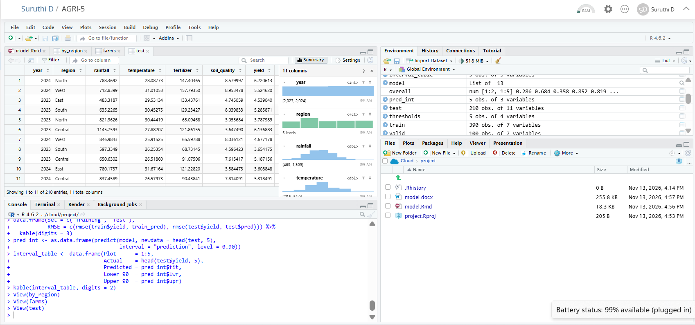

# AGRI-5: Model Evaluation and Reporting Strategy

A reproducible R project that shows how to **evaluate a predictive model and report the findings** in an agribusiness setting. It uses a hypothetical crop yield forecasting model built on simulated farm data.


> **Note:** All data and results are simulated for demonstration. They are not real farm results.

---

## Table of Contents

- [Project Overview](#project-overview)
- [Objectives](#objectives)
- [Repository Structure](#repository-structure)
- [Requirements](#requirements)
- [How to Run](#how-to-run)
- [Workflow](#workflow)
- [Performance Metrics](#performance-metrics)
- [Sample Results](#sample-results)
- [Visualizations](#visualizations)
- [Limitations and Future Work](#limitations-and-future-work)
- [Author](#author)

---

## Project Overview

Building a model is only half the job. This project sets out a complete strategy for judging a yield forecasting model and explaining the result to farm managers, procurement teams and executives. Everything is written in a single R Markdown file, so every number in the report is calculated by the code and the report can be regenerated at any time.

## Objectives

1. Identify and apply the right performance metrics (RMSE, MAE, R-squared, MAPE, bias).
2. Plan and build visuals that non-expert stakeholders can read easily.
3. Present an executive summary of model performance with recommendations.
4. Document limitations and suggestions for further model refinement.

## Repository Structure

```
AGRI-5/
├── Model Evaluation and Reporting Strategy.Rmd                          # Source: code, analysis and report text
├── Model Evaluation and Reporting Strategy.docx                         # Knitted Word report
├── project.Rproj                      # RStudio project file
├── Cover_Infographic.png              # Report cover infographic
├── RStudio_Project_Screenshot.png     # Screenshot of the project in RStudio
└── README.md
```

## Requirements

- R (version 4.x or later)
- RStudio (recommended)
- R packages: `rmarkdown`, `knitr`, `ggplot2`, `dplyr`
- Microsoft Word or LibreOffice to open the report

Install the packages once:

```r
install.packages(c("rmarkdown", "knitr", "ggplot2", "dplyr"))
```

## How to Run

1. Clone or download this repository.
2. Open `project.Rproj` in RStudio.
3. Open `Model Evaluation and Reporting Strategy.Rmd` and click **Knit** (choose *Knit to Word*), or run:

```r
rmarkdown::render("model.Rmd")
```

The report is saved as `model.docx` in the same folder. The data is simulated with a fixed seed (`set.seed(123)`), so the results are the same every time.

## Workflow

1. **Simulate or load the data:** 700 farm plots with rainfall, temperature, fertilizer, soil quality, region and yield.
2. **Split and model:** time-based split (train 2018-2021, validation 2022, test 2023-2024), a linear regression model, and a regional-average baseline.
3. **Evaluate:** calculate the metrics overall and by region.
4. **Visualize:** draw standard charts with `ggplot2`.
5. **Report:** knit an executive summary that fills in automatically from the results.
6. **Repeat:** rerun each season with new harvest data and compare.

## Performance Metrics

| Metric | What it tells you |
|:--|:--|
| **MAE** | Typical forecast miss, in tonnes per hectare (t/ha) |
| **RMSE** | Like MAE but penalizes large misses more heavily |
| **R-squared** | Share of yield variation the model explains |
| **MAPE** | Average error as a percentage of actual yield |
| **Bias** | Whether the model systematically over- or under-predicts |

## Sample Results

Test seasons 2023-2024 (simulated data):

| Metric | Model | Baseline |
|:--|:-:|:-:|
| MAE (t/ha) | 0.29 | - |
| RMSE (t/ha) | 0.36 | 0.85 |
| R-squared | 0.82 | - |

The model reduces forecast error (RMSE) by about **58%** compared with the regional-average baseline.

Average error by region (t/ha, target 0.30):

| North | Central | East | South | West |
|:-:|:-:|:-:|:-:|:-:|
| 0.20 | 0.25 | 0.27 | 0.33 | 0.38 |

North, Central and East meet the target. South and West need attention, and West is the weakest region.

## Visualizations

The report includes:

- Predicted vs actual yield
- Residual plot
- Average error by region
- Distribution of forecast errors
- Model vs baseline comparison



## Limitations and Future Work

**Limitations**

- Results come from simulated data and may not transfer to real farms.
- A short history cannot capture rare events such as severe droughts or floods.
- Changing climate and farming practices can make past patterns less reliable.
- Standard metrics treat over- and under-forecasting as equally costly.

**Future work**

- Add real farm data, satellite imagery, irrigation records and pest data.
- Report prediction intervals with every forecast.
- Compare random forests and gradient boosting against the linear model.
- Add a cost-weighted metric and stress-test on drought and flood seasons.
- Monitor errors each season and retrain on a schedule.
